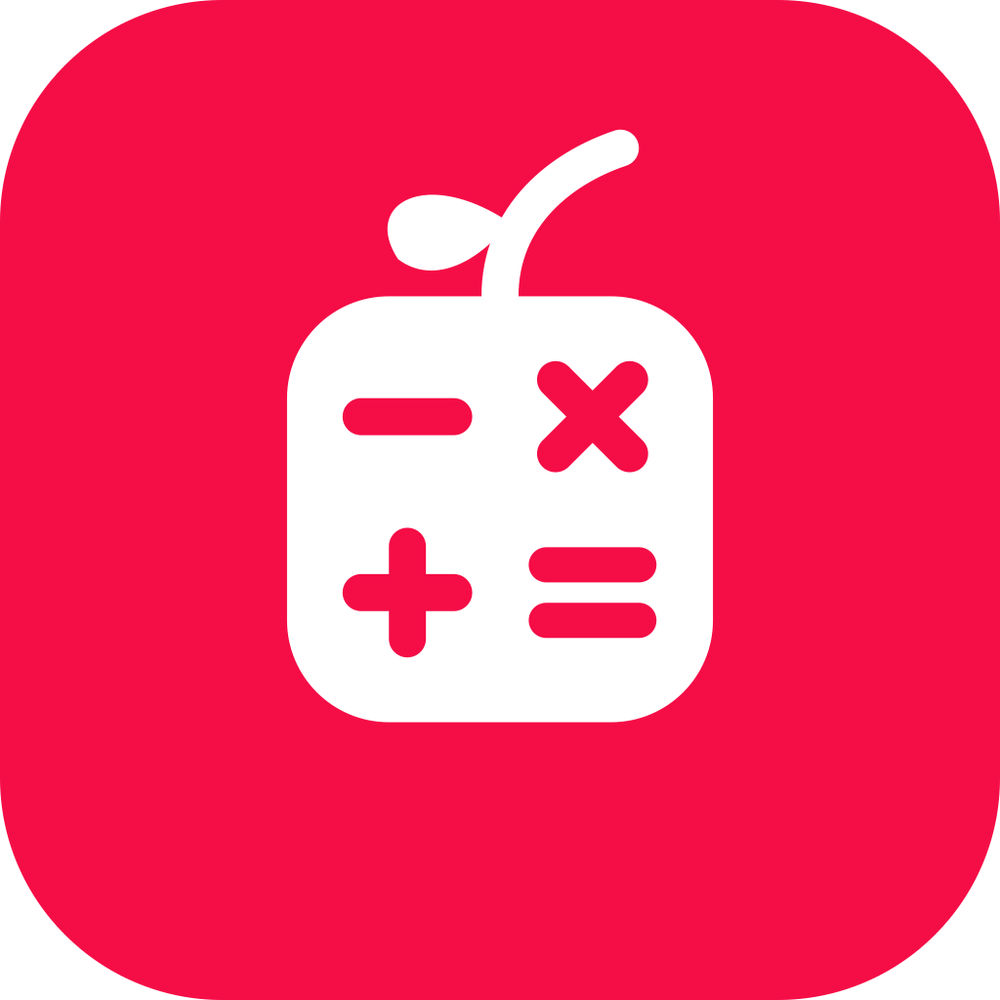
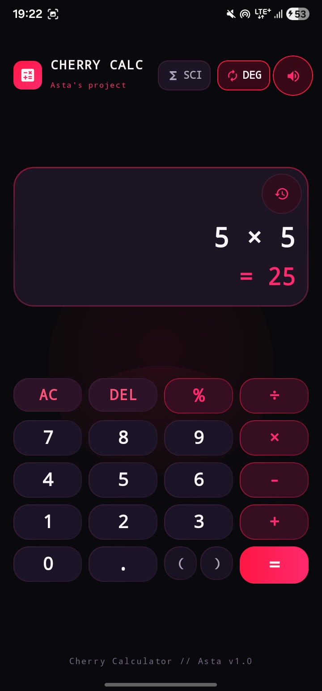
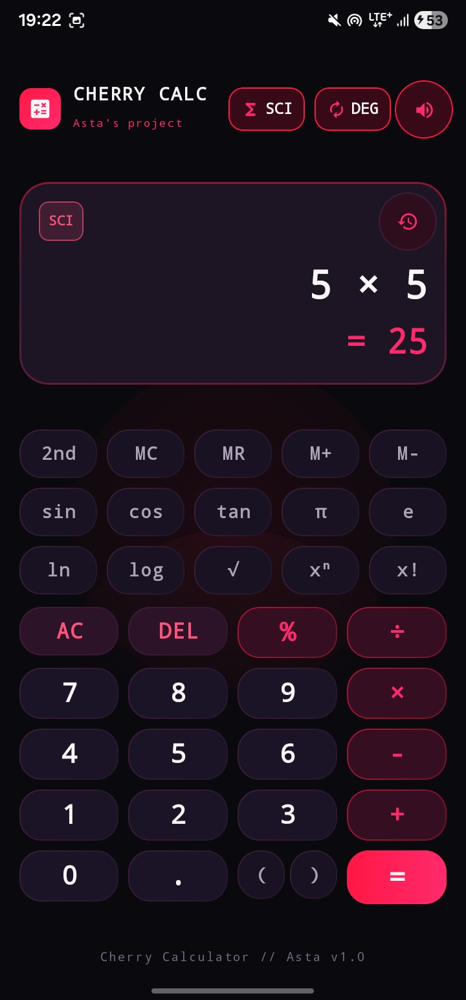
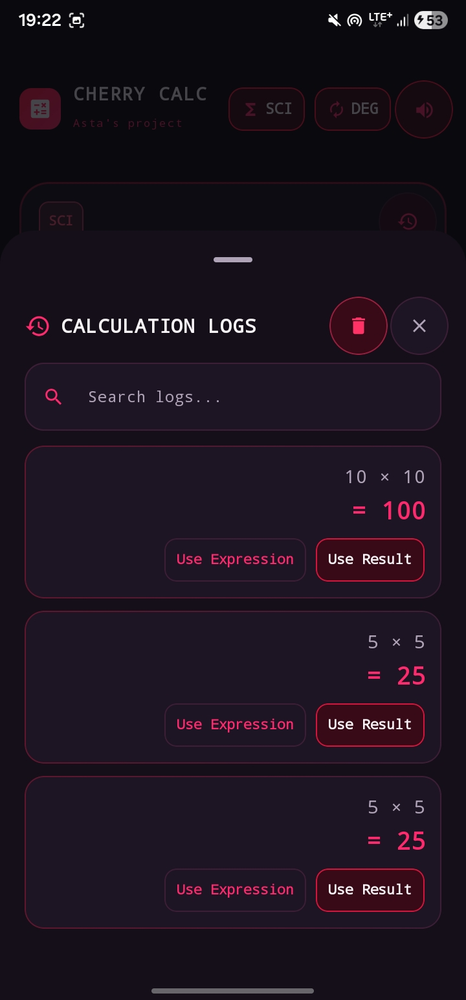

<div align="center">

# 🍒 Cherry Calculator

<p align="center">
  
</p>

> A modern, elegant, and feature-packed scientific calculator built with **Jetpack Compose** and **Material 3**, featuring a gorgeous sci-fi glassmorphic dark theme with cherry accents. 🚀✨

</div>

---

## 📱 Overview

**Cherry Calculator** is a fast, responsive scientific calculator engineered for Android. It combines everyday arithmetic convenience with advanced scientific computing capabilities. Designed with an OLED dark aesthetic and custom cherry neon gradients, it features real-time live formula previews, calculation logs, customizable haptic and audio feedback, and full landscape and tablet layout adaptations.

---

## ✨ Key Features

- 🔬 **Scientific & Basic Keypads**: Easily toggle between standard arithmetic and advanced scientific functions (`sin`, `cos`, `tan`, `ln`, `log`, $\sqrt{}$, power $x^n$, factorial $x!$, constants $\pi$ and $e$).
- ⚡ **Real-time Live Preview**: Instant calculation preview displays expressions and results dynamically as you type.
- 📐 **Angle Mode Toggle**: Seamlessly switch between Degrees (**DEG**) and Radians (**RAD**).
- 🕒 **Calculation History**: Keep track of past calculations with instant recall for expressions and results.
- 🔊 **Interactive Feedback**: Satisfying audio and tactile haptic feedback toggles for every button press.
- 📱 **Adaptive Layouts**: Optimized for single-hand portrait phones, landscape mode with side-by-side keypads, and large-screen foldables and tablets.
- 🎨 **Sci-Fi Cherry Theme**: Stunning OLED dark aesthetic powered by cherry neon gradients and smooth Material 3 animations.

---

## 📸 Screenshots & UI Preview

| Standard Calculator | Scientific Mode | Calculation Logs |
| :---: | :---: | :---: |
|  |  |  |

---

## 🛠️ Tech Stack & Architecture

- **UI Toolkit**: [Jetpack Compose](https://developer.android.com/jetpack/compose) & [Material 3](https://m3.material.io/)
- **Architecture**: MVVM (Model-View-ViewModel) with Kotlin `StateFlow` and unidirectional data flow
- **Language**: 100% [Kotlin](https://kotlinlang.org/)
- **Evaluation Engine**: Custom robust mathematical expression evaluator supporting operator precedence, parentheses, and trigonometric angle modes
- **State Management**: Lifecycle-aware state collection (`collectAsStateWithLifecycle`)

---

## 📂 Project Structure

```tree
com.asta.calculatorapp/
├── domain/evaluator/       # Mathematical expression evaluator & angle unit handling
├── ui/
│   ├── components/         # Reusable keypads, display panel, history sheets
│   ├── feedback/           # Sound & haptic feedback managers
│   ├── screens/            # Main CalculatorScreen & layouts
│   ├── theme/              # Color palettes, typography, and Material 3 theme
│   └── viewmodel/          # CalculatorViewModel & UiState
└── MainActivity.kt         # Entry point activity
```

---

## 🚀 Getting Started & Build Instructions

### Prerequisites
- Android Studio Ladybug or newer
- JDK 17 or higher
- Android SDK 24+ (Target SDK 34+)

### Build Steps

1. **Clone the repository**:
   ```bash
   git clone https://github.com/asta-JC/Cherry-Calculator.git
   cd CherryCalculator
   ```

2. **Open in Android Studio**:
   - Open Android Studio and select **Open**.
   - Navigate to the cloned `CherryCalculator` directory and let Gradle sync.

3. **Build & Run**:
   - Connect an Android device or start an emulator.
   - Run the app via Android Studio or execute via terminal:
     ```bash
     ./gradlew :app:assembleDebug
     ```

4. **Run Unit Tests**:
   ```bash
   ./gradlew :app:testDebugUnitTest
   ```

---

## 📄 License

This project is developed as part of Asta's project series. Feel free to use and adapt for personal and educational use!

---

<p align="center">
  Made with ❤️ & 🍒 by Asta
</p>
