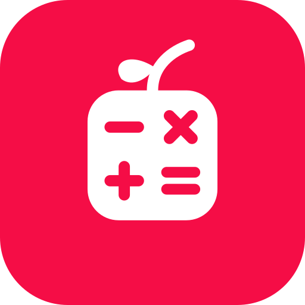
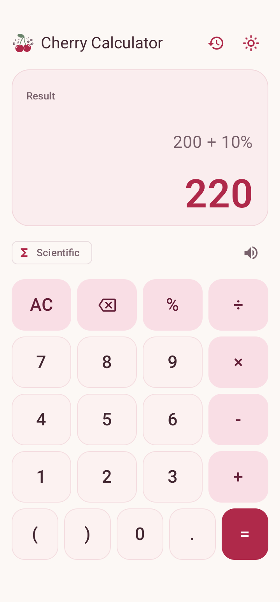
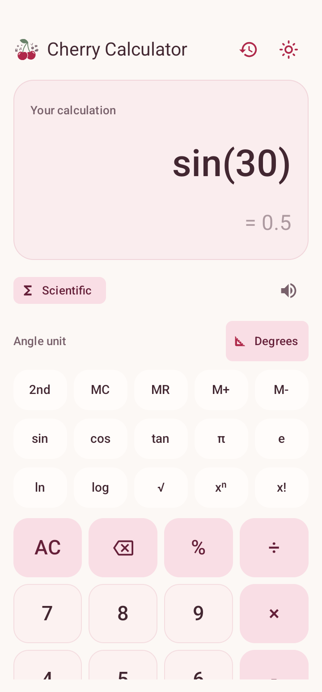
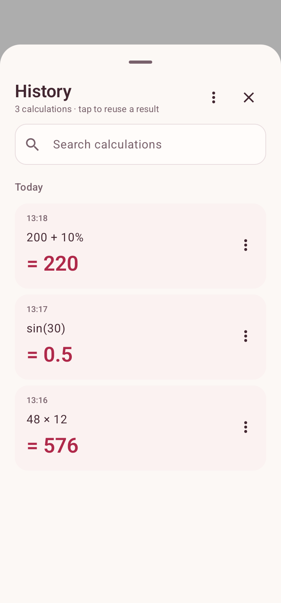

<div align="center">
  
  <h1>Cherry Calculator</h1>
  <p><strong>Everyday maths, with a little cherry.</strong></p>
  <p>A calm Android calculator for quick sums, percentages, and scientific calculations.</p>
  <p>
    
    
    
  </p>
  <p>
    <a href="https://github.com/asta-JC/Cherry-Calculator/releases/download/v1.2/Cherry-Calculator_v1.2.apk"><strong>Download APK · v1.2</strong></a> ·
    <a href="https://github.com/asta-JC/Cherry-Calculator/releases/tag/v1.2">Release notes</a>
  </p>
  <p>
    <a href="#screenshots">Screenshots</a> ·
    <a href="#features">Features</a> ·
    <a href="#getting-started">Get started</a> ·
    <a href="https://github.com/asta-JC/Cherry-Calculator/issues">Feedback</a>
  </p>
</div>

---

## Overview

Cherry Calculator keeps everyday calculations easy to follow: enter an expression, see a quiet live preview, then press equals for a clear result. Expand Scientific when you need more tools, or open History beside the appearance control to reuse an earlier answer.

## Screenshots

<table>
  <tr><th width="33%">Everyday calculations</th><th width="33%">Scientific tools</th><th width="33%">Your history</th></tr>
  <tr>
    <td align="center"></td>
    <td align="center"></td>
    <td align="center"></td>
  </tr>
  <tr><td align="center">Preview quietly. Confirm clearly.</td><td align="center">More tools when you need them.</td><td align="center">Find, reuse, or edit a calculation.</td></tr>
</table>

Captured on a physical Samsung Galaxy S22 Ultra with the production Compose screens in Light appearance. Calculations are temporary demonstration data; the capture does not change saved appearance or user history. System chrome is excluded.

## Features

- **Clear calculations:** large input, a smaller muted preview, and a prominent cherry-colored answer after equals.
- **Everyday percentages:** `50% = 0.5`, `200 × 10% = 20`, and `200 + 10% = 220`.
- **Scientific tools:** trigonometry and inverse functions, powers, roots, logarithms, factorials, constants, and memory controls. Degrees/Radians lives inside Scientific.
- **Useful history:** search recent calculations, tap to reuse a result, or choose Edit calculation from an entry's menu. Entries show dates and times; clearing history asks for confirmation.
- **Your appearance:** saved System, Light, and Dark modes with the shared CherryApps branding and optional key sounds.
- **Flexible layout:** scrolling keeps expanded controls accessible, while wider screens show history alongside the calculator.

## Compatibility

| Area | Behavior |
| :--- | :--- |
| Android | Android 7.0 / API 24 or newer |
| Calculations | Floating-point arithmetic with formatted results; very large or small values use scientific notation |
| Percentages | Addition/subtraction uses the left amount as the base for a percentage operand; multiplication/division uses its decimal value |
| History and memory | Kept in the current app session; they are not saved across process restarts |
| Appearance | Saved locally and restored on launch |

## Getting started

### Download

Install [Cherry-Calculator_v1.2.apk](https://github.com/asta-JC/Cherry-Calculator/releases/download/v1.2/Cherry-Calculator_v1.2.apk) from [GitHub Releases](https://github.com/asta-JC/Cherry-Calculator/releases/tag/v1.2). This is a **debug/test-signed** build using the existing development certificate. The release includes `SHA256SUMS.txt` for download verification.

### Requirements

- A physical Android device running Android 7.0 or newer.
- Android Studio compatible with the pinned Gradle and Android Gradle Plugin versions.
- Android SDK 37 and JDK 25 for the project's Gradle daemon. The app targets Java 11 bytecode.

### Build and run

```bash
git clone https://github.com/asta-JC/Cherry-Calculator.git
cd Cherry-Calculator
./gradlew :app:assembleDebug
adb -s YOUR_DEVICE_SERIAL install -r app/build/outputs/apk/debug/app-debug.apk
```

The APK is generated at `app/build/outputs/apk/debug/app-debug.apk`. The distribution build uses the existing **debug/test signing certificate**, not a separate production key.

### Tests

```bash
./gradlew :app:testDebugUnitTest :app:lintDebug
```

The README gallery is reproducible on a physical phone using [the capture instructions](docs/screenshots/README.md).

## Built with

| Layer | Technology |
| :--- | :--- |
| Interface | Kotlin, Jetpack Compose, Material 3 |
| State | ViewModel, StateFlow, lifecycle-aware collection |
| Mathematics | Local expression parser with operator precedence, functions, and angle modes |
| Preferences | Android SharedPreferences for appearance |
| Verification | JUnit, Compose UI tests, Android instrumentation |

## What's new in 1.2

- Shared cream, rose, and plum CherryApps styling with the original launcher icon preserved.
- Larger input, subtle previews, and clear confirmed results.
- Redesigned history and a header shortcut beside the appearance toggle.
- Calculator-style percentages and angle units inside Scientific.

## Feedback

[Open an issue](https://github.com/asta-JC/Cherry-Calculator/issues) with your device, Android version, app version, and steps to reproduce. For calculation problems, include the expression, angle mode, expected answer, and actual answer. Use non-sensitive examples.

## License & credits

This project is developed as part of Asta's project series. Feel free to use and adapt for personal and educational use!

The repository does not include a standalone license file. Third-party dependencies retain their own licenses. Interface icons come from Material Icons.

---

<p align="center">
  <strong>Made with ❤️ &amp; 🍒 by Asta</strong><br />
  <sub>Part of the CherryApp family.</sub>
</p>
